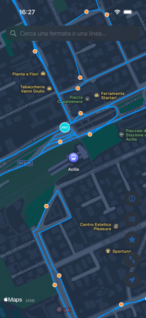
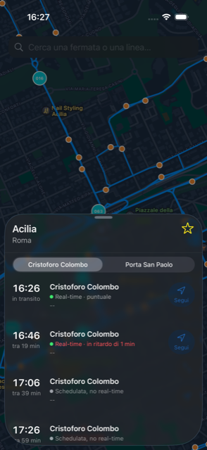
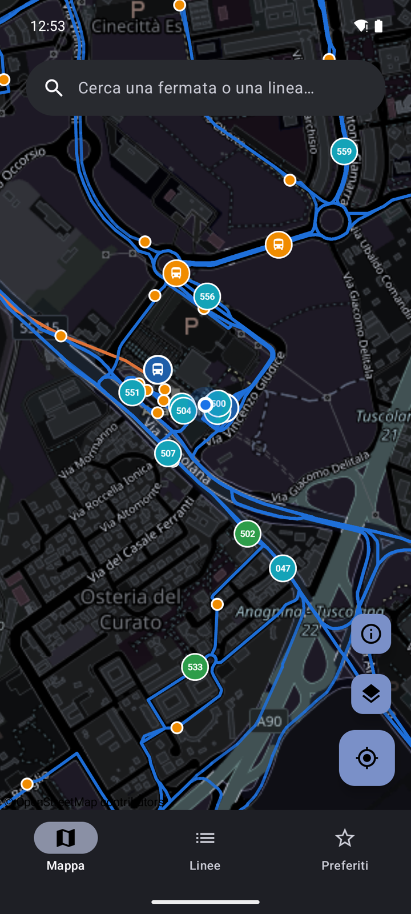
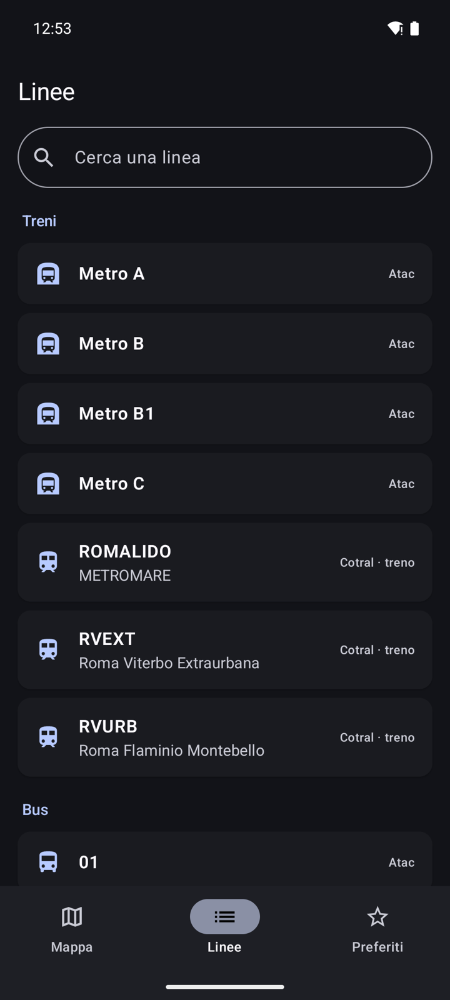

<p align="center">
  
</p>

<h1 align="center">Madovai</h1>

<p align="center"><em>"Ma dove vai?"</em> — bus, tram, metro e treni di Roma e del Lazio su un'unica mappa, in tempo reale.</p>

<p align="center">
  <a href="https://gab8bit.github.io/Madovai/"><b>Sito e download</b></a> ·
  <a href="https://github.com/Gab8bit/Madovai/releases">Release</a> ·
  <a href="https://app.gab8bit.net/madovai/">Web app</a>
</p>

---

Madovai mette insieme **Cotral** (bus e treni extraurbani del Lazio) e **Atac / Roma TPL** (trasporto urbano di Roma), due reti che di solito vivono in due app diverse: posizione dei mezzi, orari per fermata, ritardi, linee, preferiti e promemoria. Gratuita, senza account e senza pubblicità.

<p align="center">
  
  &nbsp;
  
  &nbsp;
  
  &nbsp;
  
</p>
<p align="center"><sub>iPhone (le prime due) e Android (le ultime due)</sub></p>

## Le versioni

Un solo repository, una cartella per versione:

| Cartella | Cosa | Tecnologia | Come si ottiene |
|---|---|---|---|
| [`iOS/`](iOS) | App per iPhone (iOS 16+) | SwiftUI, MapKit, xcodegen | IPA nelle [release](https://github.com/Gab8bit/Madovai/releases?q=ios&expanded=true), si installa con SideStore/AltStore — [guida](https://gab8bit.github.io/Madovai/ios/) |
| [`Android/`](Android) | App per Android (8.0+) | Kotlin, Jetpack Compose, Material 3, osmdroid | APK nelle [release](https://github.com/Gab8bit/Madovai/releases?q=android&expanded=true) — [guida](https://gab8bit.github.io/Madovai/android/) |
| [`Web/`](Web) | PWA da browser, installabile in Home | Preact + htm, Leaflet, nessuna build | [app.gab8bit.net/madovai](https://app.gab8bit.net/madovai/) |
| [`Backend/`](Backend) | API che unisce e mette in cache i dati di tutte le fonti, più le notifiche dei promemoria | Node.js 24, TypeScript, Fastify, SQLite, Docker | `https://madovai.gab8bit.net/api/v1` — si fa girare con Docker, vedi [`Backend/README.md`](Backend/README.md) |
| [`docs/`](docs) | Sito GitHub Pages: pagina principale, `ios/`, `android/` | HTML statico | [gab8bit.github.io/Madovai](https://gab8bit.github.io/Madovai/) |

Come sono collegate:

```
 Cotral (PIV.do, GTFS) ─┐
 ASTRAL (treni)        ─┼─►  Backend  ──►  iOS 2.x
 Roma Mobilità (GTFS,  ─┘   /api/v1   └─►  Web 1.1+
   GTFS-Realtime)
        └──────────────────────────────►  Android 1.x  (legge ancora le fonti direttamente)
```

Ogni cartella ha il suo README con architettura, build e scelte di dettaglio. La storia git dei quattro progetti originali è stata conservata: `git log -- iOS/` mostra tutti i commit dell'app iOS dal primo.

## Release

Ogni piattaforma ha la sua numerazione e i suoi tag:

| Tag | Allegato |
|---|---|
| `ios-vX.Y.Z` | `Madovai.ipa` |
| `android-vX.Y.Z` | `Madovai-vX.Y.Z.apk` (firmato con la chiave di release) |
| `web-vX.Y.Z` | — (la web app si aggiorna sul server) |
| `backend-vX.Y.Z` | — (immagine Docker costruita dal sorgente) |

Quando più piattaforme escono insieme si crea **una sola release** con tutti i file allegati (es. tag `ios-v2.1.0` + `android-v1.1.0` sullo stesso commit, release con IPA e APK). Le pagine di download cercano da sole l'ultima release che contiene un `.ipa` o un `.apk`, quindi non vanno mai modificate a mano.

## Dati e licenze

Fermate, linee e orari vengono dai feed pubblici GTFS di Cotral e di Roma Servizi per la Mobilità (CC-BY 3.0 Italia); le posizioni in tempo reale dagli endpoint pubblici di Cotral, dal servizio orari di ASTRAL e dai feed GTFS-Realtime di Roma Servizi per la Mobilità. Mappe: Apple Maps su iOS, © [OpenStreetMap contributors](https://www.openstreetmap.org/copyright) su Android e Web.

Progetto indipendente, non affiliato con Cotral, ASTRAL o Roma Capitale/Atac.
